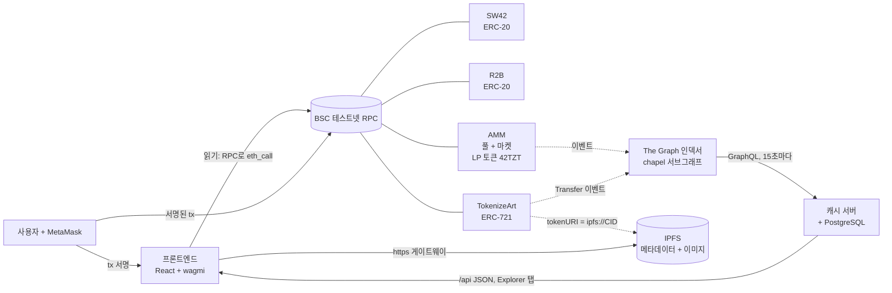
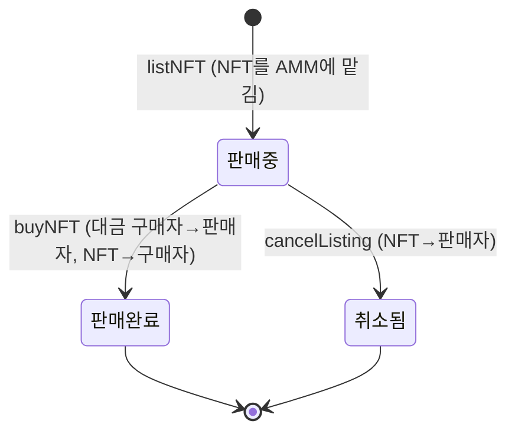
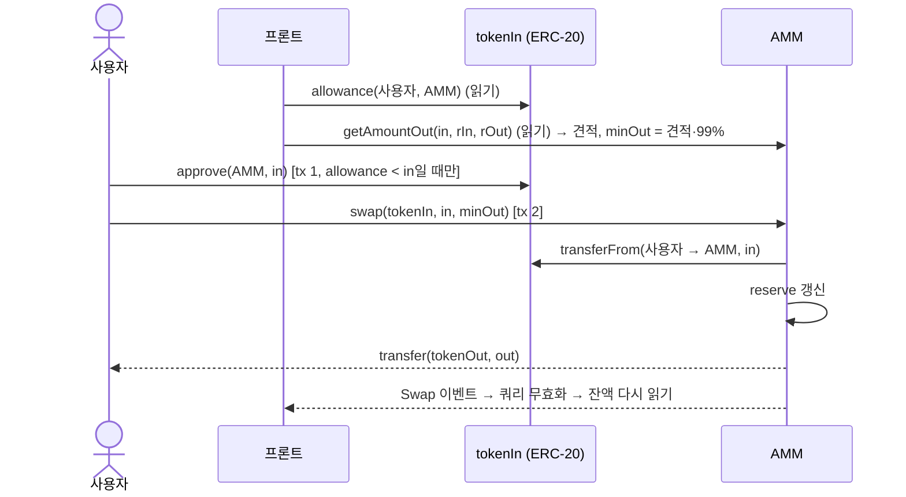

# 구조 설명

[English](architecture.md) · **한국어**

## 1. 전체 구조



- **읽기**(잔액, reserve, 견적, 판매 목록)는 wagmi의 HTTP transport가 RPC 노드에 바로 묻습니다. 비용이 없고 MetaMask 팝업도 뜨지 않습니다.
- **쓰기**(approve, swap, addLiquidity, listNFT …)는 MetaMask에서 서명한 뒤 체인으로 전송됩니다.
- **서브그래프**는 시작 블록부터 컨트랙트 이벤트를 다시 읽으며 풀 상태, 기록, 판매 건, NFT 소유자를 인덱싱해 둡니다.
- **캐시 서버**는 15초마다 서브그래프를 우리 PostgreSQL에 복사하고, Explorer 탭에 JSON API로 제공합니다 ([cache-server.ko.md](cache-server.ko.md)).
- **NFT 메타데이터**는 IPFS에 있습니다. 컨트랙트에는 `ipfs://` 주소만 저장됩니다.

## 2. 컨트랙트

| 컨트랙트 | 파일 | 상속 | 역할 |
|---|---|---|---|
| `SunWoo42` (SW42) | `code/src/SunWoo42.sol` | `ERC20`, `ERC20Permit`, `Ownable` | Token A |
| `TokenB` (R2B, "Ra2techB") | `code/src/tokenB.sol` | `ERC20`, `ERC20Permit`, `Ownable` | Token B |
| `AMM` (LP 토큰 "42TokenZwapToken" / 42TZT) | `code/src/AMM.sol` | `ERC20`, `ReentrancyGuard` | 풀과 NFT 마켓 |
| `TokenizeArt` ("42 Korean Hacker" / 42KH) | `code/src/TokenizeArt.sol` | `ERC721`, `Ownable` | 데모 NFT 컬렉션 |

### 2.1 테스트 토큰 (SW42, R2B)

| 함수 | 누가 | 동작 |
|---|---|---|
| `constructor(initialSupply)` | 배포자 | 배포자에게 `initialSupply` 발행, owner 설정 |
| `faucet()` | 누구나 | 호출자에게 `FAUCET_AMOUNT` = 1000개 발행. 마지막 수령 후 `FAUCET_COOLDOWN` = 1일이 안 지났으면 `"Faucet cooldown: 1 day"`로 revert |
| `mint(to, amount)` | owner | 원하는 양 발행 (테스트 지갑 충전용) |

`faucet()`은 발행 **전에** `lastFaucetClaim[msg.sender]`를 기록하고, 표준 `Transfer(0x0 → 수령자)` 옆에 `FaucetClaimed(수령자, 양)`을 남깁니다.
두 토큰 모두 decimals 18이라 `1개 = 10^18` 단위로 저장됩니다.

### 2.2 AMM 풀

상태:

| 변수 | 종류 | 뜻 |
|---|---|---|
| `tokenA`, `tokenB` | `immutable` | 배포 때 고정되는 토큰 쌍 |
| `FEE_BPS` = 300, `BPS_DENOMINATOR` = 10,000 | `constant` | swap 수수료 3% (요구 범위 1%~10%) |
| `reserveA`, `reserveB` | storage | 풀이 가진 토큰의 내부 장부 |
| LP 잔액 / `totalSupply` | `ERC20` 상속 | 풀 지분 |

함수:

| 함수 | 검사 | 상태 변경 | 외부 호출 | 이벤트 |
|---|---|---|---|---|
| `addLiquidity(a, b)` | `a > 0 && b > 0`, 발행 LP > 0 | 빈 풀이면 LP = `√(a·b)`, 아니면 `min(a·L/x, b·L/y)`; reserve += a, b | 호출자에게서 A, B `transferFrom` 후 LP 발행 | `LiquidityAdded(provider, a, b, liquidity)` |
| `removeLiquidity(lp)` | `lp > 0`, 두 양 모두 > 0 | `amountX = lp·reserveX / L`; LP 소각; reserve −= 양 | 호출자에게 A, B 전송 | `LiquidityRemoved(provider, lp, a, b)` |
| `getAmountOut(in, rIn, rOut)` | `in > 0`, reserve > 0 | `pure`: `in·9700·rOut / (rIn·10000 + in·9700)` | – | – |
| `swap(tokenIn, in, minOut)` | tokenIn이 A 또는 B, `out ≥ minOut`, `out > 0` | reserveIn += in, reserveOut −= out | tokenIn `transferFrom` 후 tokenOut 전송 | `Swap(trader, tokenIn, in, out)` |

설계 선택:

- **`balanceOf` 대신 내부 reserve.** 컨트랙트에 직접 보낸 토큰은 계산에 들어가지 않습니다. 그래서 기부(donation)로 가격을 움직이거나 LP 지분 가치를 부풀릴 수 없습니다.
- **반올림은 풀에 유리하게.** 모든 나눗셈이 버림이라(받는 양, 발행 LP, 회수 양) `k = reserveA · reserveB`는 줄지 않습니다. `test_Swap_AToB_Invariants`가 확인합니다.
- **수수료는 풀에 남김.** 3%를 따로 떼지 않고 reserve에 남깁니다. 그래서 swap이 일어날 때마다 LP 1개의 가치가 조금씩 올라갑니다.
- **슬리피지 보호.** `swap`은 `minAmountOut`을 받습니다. 프론트는 견적의 99%로 정합니다.
- **재진입 방지.** 상태를 바꾸는 풀·마켓 함수는 모두 `nonReentrant`이고 검사 → 상태 변경 → 외부 호출 순서를 따릅니다. ERC-20 호출은 `SafeERC20`을 거칩니다.

숫자 예시 (풀 A 10,000 / B 40,000, 100 A swap):

| 단계 | 값 |
|---|---|
| 현재 가격 | 1 A = 4 B → 수수료와 가격 충격이 없다면 400 B |
| 수수료 3% 포함 | `100·0.97·40000 / (10000 + 97)` = **384.2725…** B |
| `minAmountOut` (1%) | 380.4298… B |
| swap 후 풀 | A 10,100 / B 39,615.7274…, `k` 400,000,000 → 400,118,847 (수수료가 풀에 남음) |

쉬운 숫자로 정리한 공식: [amm-math.ko.md](amm-math.ko.md). swap 한 번의 storage 변화를 한 줄씩 따라간 문서: [swap-trace.ko.md](swap-trace.ko.md).

### 2.3 NFT 마켓 (`AMM` 안)

```solidity
struct Listing {
    address seller;      // 대금 수령, 취소 권한
    IERC721 nft;         // NFT 컨트랙트
    uint256 tokenId;
    uint256 price;       // 결제 토큰 단위 (decimals 18)
    IERC20 paymentToken; // tokenA 또는 tokenB
    bool active;         // 팔리거나 취소되면 false
}
uint256 public nextListingId;
mapping(uint256 => Listing) public listings;
```

| 함수 | 검사 | 상태 변경 | 외부 호출 | 이벤트 |
|---|---|---|---|---|
| `listNFT(nft, tokenId, price, paymentToken)` | 결제 토큰이 A 또는 B, `price > 0` | 판매 건 저장 (`seller = msg.sender`, active), `nextListingId++` | `nft.transferFrom(판매자 → AMM)` (escrow) | `NFTListed` |
| `cancelListing(id)` | active, `msg.sender == seller` | `active = false` (`storage` 참조로) | `nft.transferFrom(AMM → 판매자)` | `NFTListingCancelled` |
| `buyNFT(id)` | active | `active = false` | `paymentToken.safeTransferFrom(구매자 → 판매자, price)` 후 `nft.transferFrom(AMM → 구매자)` | `NFTSold` |



- **에스크로.** 판매 중에는 AMM이 NFT를 소유하므로, 판매자가 다른 곳에 팔 수 없습니다.
- **풀과 독립.** 대금은 구매자에게서 판매자에게 바로 가며, AMM 잔액이나 reserve를 거치지 않습니다(`test_Marketplace_DoesNotTouchPoolReserves`).
- **소유 확인은 NFT 컨트랙트가 합니다.** `listNFT`가 `transferFrom`에 `from = msg.sender`를 넘기므로, 주인이 아니거나(`ERC721IncorrectOwner`) AMM에게 허락하지 않은 호출자(`ERC721InsufficientApproval`)는 ERC-721 컨트랙트에서 거부됩니다.
- 받는 쪽이 ERC-721을 다룰 줄 아는 AMM 자신이라서 `safeTransferFrom` 대신 `transferFrom`을 씁니다.
- 끝난 판매 건은 `active = false`로 storage에 남습니다. 같은 NFT를 다시 등록하면 새 번호를 받습니다.

### 2.4 `TokenizeArt` (ERC-721)

`mint(to)`는 owner 전용이고 번호를 0, 1, 2, … 순서로 매깁니다(`_safeMint`). `tokenURI(id)`는 존재하는 모든 번호에 같은 IPFS 주소를 돌려줍니다. 배포 스크립트가 #0~#2를 배포자에게 발행합니다.

## 3. 주요 흐름

### Swap (트랜잭션 2개)



### 유동성 공급

프론트가 `amountB = amountA · reserveB / reserveA`를 계산해 풀 비율에 맞춘 뒤, approve A → approve B → `addLiquidity` 순서로 진행합니다. 풀이 비어 있으면 두 양을 모두 입력하고, 그 비율이 첫 가격이 됩니다.

### NFT 구매

`paymentToken.approve(AMM, price)` → `buyNFT(id)`. tx 하나에서 로그 3개가 순서대로 나옵니다: ERC-20 `Transfer(구매자 → 판매자)`, ERC-721 `Transfer(AMM → 구매자)`, `NFTSold`.

## 4. 이벤트

| 컨트랙트 | 이벤트 | indexed |
|---|---|---|
| AMM | `LiquidityAdded(provider, amountA, amountB, liquidity)` | provider |
| AMM | `LiquidityRemoved(provider, liquidity, amountA, amountB)` | provider |
| AMM | `Swap(trader, tokenIn, amountIn, amountOut)` | trader, tokenIn |
| AMM | `NFTListed(listingId, seller, nft, tokenId, paymentToken, price)` | listingId, seller, nft |
| AMM | `NFTListingCancelled(listingId, seller)` | listingId, seller |
| AMM | `NFTSold(listingId, buyer, seller, price)` | listingId, buyer, seller |
| SW42 / R2B | `FaucetClaimed(recipient, amount)` | recipient |
| TokenizeArt | `Transfer(from, to, tokenId)` | 셋 다 |

## 5. 프론트엔드

`frontend/src/` — `config.ts`(체인 anvil / bscTestnet / sepolia, injected 커넥터, 체인별 HTTP transport), `contracts.ts`(체인 ID별 주소, `parseAbi`로 쓴 ABI), `App.tsx`(컴포넌트)

| 컴포넌트 | 읽기 | 쓰기 |
|---|---|---|
| `WalletBar` | 연결 상태 | 연결, 체인 전환, 연결 해제 |
| `PoolInfo` | reserve, LP 총량 | – |
| `MyBalance` | SW42, R2B, LP 잔액 | `faucet()` |
| `Swap` | reserve, `getAmountOut`, allowance | approve → `swap` |
| `AddLiquidity` | reserve, LP 총량, allowance 2개 | approve A → approve B → `addLiquidity` |
| `RemoveLiquidity` | LP 잔액, reserve | `removeLiquidity` (approve 없음: AMM이 자기 LP 토큰을 소각) |
| `MyNFTs` + `ListNFTForm` | `ownerOf(0..19)`, `tokenURI`, IPFS 메타데이터, `getApproved` | `nft.approve` → `listNFT` |
| `Market` + `ListingCard` | `nextListingId`, `listings(i)`, allowance | `cancelListing`, 또는 approve → `buyNFT` |

모든 쓰기는 같은 패턴입니다: `useWriteContract` → `useWaitForTransactionReceipt` → `queryClient.invalidateQueries()`. tx가 채굴되면 화면의 모든 읽기가 다시 실행됩니다.

## 6. 테스트

`code/test/AMM.t.sol`(6개)와 `code/test/NFTMarket.t.sol`(8개), 총 14개 모두 통과(`forge test`). 한 줄씩 설명한 자료: [test-guide.pdf](test-guide.pdf)
