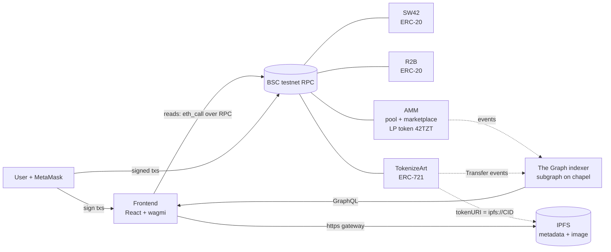
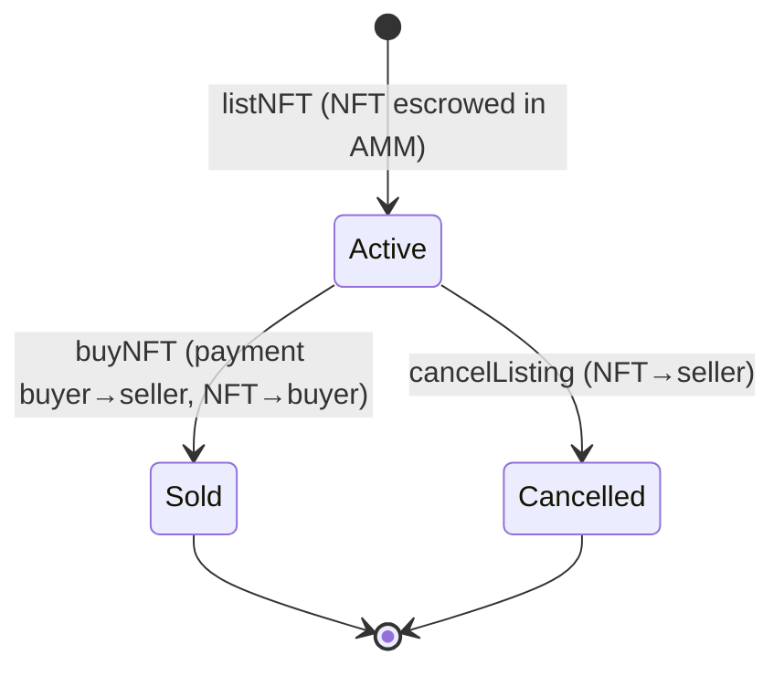
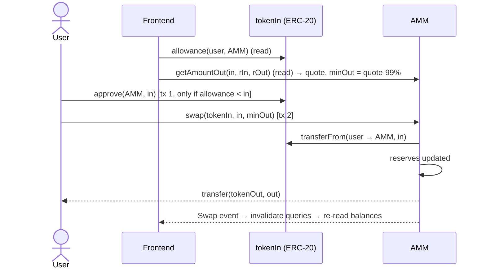

# Architecture

**English** · [한국어](architecture.ko.md)

## 1. System overview



- **Reads** (balances, reserves, quotes, listings) go from wagmi's HTTP transport straight to the RPC node. They cost nothing and do not open MetaMask.
- **Writes** (approve, swap, addLiquidity, listNFT, …) are signed in MetaMask and broadcast to the chain.
- The **subgraph** replays contract events from the start block and keeps an indexed copy of pool state, history, listings and NFT owners.
- **NFT metadata** lives on IPFS. The contract stores only the `ipfs://` URI.

## 2. Contracts

| Contract | File | Inherits | Purpose |
|---|---|---|---|
| `SunWoo42` (SW42) | `code/src/SunWoo42.sol` | `ERC20`, `ERC20Permit`, `Ownable` | Token A |
| `TokenB` (R2B, "Ra2techB") | `code/src/tokenB.sol` | `ERC20`, `ERC20Permit`, `Ownable` | Token B |
| `AMM` (LP token "42TokenZwapToken" / 42TZT) | `code/src/AMM.sol` | `ERC20`, `ReentrancyGuard` | Pool and NFT marketplace |
| `TokenizeArt` ("42 Korean Hacker" / 42KH) | `code/src/TokenizeArt.sol` | `ERC721`, `Ownable` | Demo NFT collection |

### 2.1 Test tokens (SW42, R2B)

| Function | Who | Effect |
|---|---|---|
| `constructor(initialSupply)` | deployer | mints `initialSupply` to the deployer, sets the owner |
| `faucet()` | anyone | mints `FAUCET_AMOUNT` = 1000 tokens to the caller; reverts with `"Faucet cooldown: 1 day"` if the caller claimed less than `FAUCET_COOLDOWN` = 1 day ago |
| `mint(to, amount)` | owner | mints any amount (used to top up test wallets) |

`faucet()` records `lastFaucetClaim[msg.sender]` before minting and emits `FaucetClaimed(recipient, amount)` next to the standard `Transfer(0x0 → recipient)`.
Both tokens have 18 decimals, so `1 token = 10^18` units on-chain.

### 2.2 AMM pool

State:

| Variable | Kind | Meaning |
|---|---|---|
| `tokenA`, `tokenB` | `immutable` | the pair, fixed at deployment |
| `FEE_BPS` = 300, `BPS_DENOMINATOR` = 10,000 | `constant` | 3% swap fee (required range: 1%–10%) |
| `reserveA`, `reserveB` | storage | internal ledger of pooled tokens |
| LP balances / `totalSupply` | inherited `ERC20` | ownership shares of the pool |

Functions:

| Function | Checks | Effects | Interactions | Event |
|---|---|---|---|---|
| `addLiquidity(a, b)` | `a > 0 && b > 0`, minted LP > 0 | LP = `√(a·b)` if the pool is empty, else `min(a·L/x, b·L/y)`; reserves += a, b | `transferFrom` A and B from the caller, then mint LP | `LiquidityAdded(provider, a, b, liquidity)` |
| `removeLiquidity(lp)` | `lp > 0`, both amounts > 0 | `amountX = lp·reserveX / L`; burn LP; reserves −= amounts | transfer A and B to the caller | `LiquidityRemoved(provider, lp, a, b)` |
| `getAmountOut(in, rIn, rOut)` | `in > 0`, reserves > 0 | `pure`: `in·9700·rOut / (rIn·10000 + in·9700)` | – | – |
| `swap(tokenIn, in, minOut)` | tokenIn is A or B, `out ≥ minOut`, `out > 0` | reserveIn += in, reserveOut −= out | `transferFrom` tokenIn, then transfer tokenOut | `Swap(trader, tokenIn, in, out)` |

Design choices:

- **Internal reserves instead of `balanceOf`.** Tokens sent directly to the contract are not counted, so a donation cannot move the price or inflate LP share value.
- **Rounding favors the pool.** Every division rounds down (output, LP minted, LP redeemed), so `k = reserveA · reserveB` never decreases. The test `test_Swap_AToB_Invariants` checks this.
- **Fee stays in the pool.** The 3% is not split out. It remains in the reserves, so each LP token is worth a little more after every swap.
- **Slippage protection.** `swap` takes `minAmountOut`. The frontend sets it to the quote minus 1%.
- **Reentrancy.** Every state-changing pool and marketplace function is `nonReentrant` and follows checks → effects → interactions. ERC-20 calls go through `SafeERC20`.

Worked numbers (pool 10,000 A / 40,000 B, swap 100 A):

| Step | Value |
|---|---|
| Spot price | 1 A = 4 B → 400 B without fee or price impact |
| With 3% fee | `100·0.97·40000 / (10000 + 97)` = **384.2725…** B |
| `minAmountOut` (1%) | 380.4298… B |
| Pool after | 10,100 A / 39,615.7274… B, `k` 400,000,000 → 400,118,847 (the fee stays in the pool) |

More math with round numbers: [amm-math.md](amm-math.md) (Korean). Step-by-step storage trace of one swap: [swap-trace.md](swap-trace.md) (Korean).

### 2.3 NFT marketplace (inside `AMM`)

```solidity
struct Listing {
    address seller;      // receives the payment, may cancel
    IERC721 nft;         // NFT contract
    uint256 tokenId;
    uint256 price;       // in paymentToken units (18 decimals)
    IERC20 paymentToken; // tokenA or tokenB
    bool active;         // false once sold or cancelled
}
uint256 public nextListingId;
mapping(uint256 => Listing) public listings;
```

| Function | Checks | Effects | Interactions | Event |
|---|---|---|---|---|
| `listNFT(nft, tokenId, price, paymentToken)` | paymentToken is A or B, `price > 0` | store listing (`seller = msg.sender`, active), `nextListingId++` | `nft.transferFrom(seller → AMM)` (escrow) | `NFTListed` |
| `cancelListing(id)` | active, `msg.sender == seller` | `active = false` (via a `storage` reference) | `nft.transferFrom(AMM → seller)` | `NFTListingCancelled` |
| `buyNFT(id)` | active | `active = false` | `paymentToken.safeTransferFrom(buyer → seller, price)`, then `nft.transferFrom(AMM → buyer)` | `NFTSold` |



- **Escrow.** While a listing is active, the AMM owns the NFT, so the seller cannot sell it elsewhere.
- **Independence from the pool.** The payment goes straight from buyer to seller and never passes through the AMM balance or the reserves (`test_Marketplace_DoesNotTouchPoolReserves`).
- **Ownership is enforced by the NFT contract.** `listNFT` passes `from = msg.sender` to `transferFrom`, so the ERC-721 contract rejects a caller who is not the owner (`ERC721IncorrectOwner`) or who has not approved the AMM (`ERC721InsufficientApproval`).
- `transferFrom` is used instead of `safeTransferFrom` because the receiver is the AMM itself, which is known to handle ERC-721 tokens.
- Finished listings stay in storage with `active = false`. Relisting the same NFT creates a new id.

### 2.4 `TokenizeArt` (ERC-721)

`mint(to)` is owner-only and assigns ids 0, 1, 2, … (`_safeMint`). `tokenURI(id)` returns the same IPFS URI for every existing token. The deploy script mints #0–#2 to the deployer.

## 3. Main flows

### Swap (two transactions)



### Add liquidity

The frontend computes `amountB = amountA · reserveB / reserveA` so the deposit matches the pool ratio, then runs approve A → approve B → `addLiquidity`. On an empty pool the user enters both amounts and sets the initial price.

### Buy an NFT

`paymentToken.approve(AMM, price)` → `buyNFT(id)`. One transaction emits three logs in order: ERC-20 `Transfer(buyer → seller)`, ERC-721 `Transfer(AMM → buyer)`, `NFTSold`.

## 4. Events

| Contract | Event | Indexed |
|---|---|---|
| AMM | `LiquidityAdded(provider, amountA, amountB, liquidity)` | provider |
| AMM | `LiquidityRemoved(provider, liquidity, amountA, amountB)` | provider |
| AMM | `Swap(trader, tokenIn, amountIn, amountOut)` | trader, tokenIn |
| AMM | `NFTListed(listingId, seller, nft, tokenId, paymentToken, price)` | listingId, seller, nft |
| AMM | `NFTListingCancelled(listingId, seller)` | listingId, seller |
| AMM | `NFTSold(listingId, buyer, seller, price)` | listingId, buyer, seller |
| SW42 / R2B | `FaucetClaimed(recipient, amount)` | recipient |
| TokenizeArt | `Transfer(from, to, tokenId)` | all three |

## 5. Frontend

`frontend/src/` — `config.ts` (chains anvil / bscTestnet / sepolia, injected connector, one HTTP transport per chain), `contracts.ts` (addresses per chain id and ABIs written with `parseAbi`), `App.tsx` (components).

| Component | Reads | Writes |
|---|---|---|
| `WalletBar` | connection state | connect, switch chain, disconnect |
| `PoolInfo` | reserves, LP total supply | – |
| `MyBalance` | SW42, R2B, LP balances | `faucet()` |
| `Swap` | reserves, `getAmountOut`, allowance | approve → `swap` |
| `AddLiquidity` | reserves, LP supply, allowances | approve A → approve B → `addLiquidity` |
| `RemoveLiquidity` | LP balance, reserves | `removeLiquidity` (no approve: the AMM burns its own LP token) |
| `MyNFTs` + `ListNFTForm` | `ownerOf(0..19)`, `tokenURI`, IPFS metadata, `getApproved` | `nft.approve` → `listNFT` |
| `Market` + `ListingCard` | `nextListingId`, `listings(i)`, allowance | `cancelListing`, or approve → `buyNFT` |

Every write follows the same pattern: `useWriteContract` → `useWaitForTransactionReceipt` → `queryClient.invalidateQueries()` so every on-screen read refreshes once the transaction is mined.

## 6. Tests

`code/test/AMM.t.sol` (6) and `code/test/NFTMarket.t.sol` (8): 14 tests, all passing (`forge test`). A line-by-line walkthrough is in [test-guide.pdf](test-guide.pdf) (Korean).
