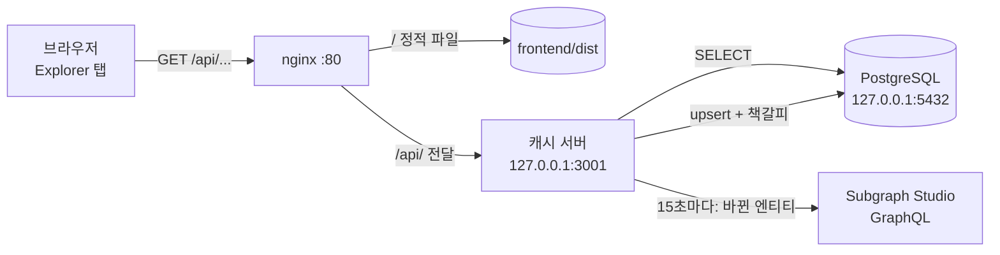

# 캐시 서버와 explorer

[English](cache-server.md) · **한국어**

앱의 Explorer 탭은 The Graph에 직접 묻지 않습니다. 작은 Node 서버가 15초마다 서브그래프를 우리 PostgreSQL에 복사해 두고, 그걸 JSON API로 내줍니다. 소스: [`code/cache-server/`](../code/cache-server)

## 왜 필요한가

| 브라우저가 Subgraph Studio에 직접 물으면 | 캐시 서버를 쓰면 |
|---|---|
| 방문자마다 사용량 제한이 있는 Studio 주소를 부름 | 프로세스 하나가 15초마다 변경분만 가져오고, 방문자는 우리 DB를 읽음 |
| 데이터가 Studio에만 있음 | 우리 PostgreSQL에 사본이 있어 SQL로 조회 가능 |
| GraphQL 쿼리가 프론트에 있음 | 프론트는 `/api/pool` 같은 주소만 부르고, 쿼리는 서버에 있음 |

## 구조



인터넷에서 닿는 것은 nginx(80/443)와 SSH(22)뿐입니다. 캐시 서버와 PostgreSQL은 `127.0.0.1`에서만 듣고, 방화벽도 한 번 더 막습니다.

## 파일

| 파일 | 역할 |
|---|---|
| `src/db.ts` | 연결 풀(`DATABASE_URL`). `initDb()`는 테이블 생성, `getLastBlock()` / `setLastBlock()`은 동기화 책갈피 읽기/쓰기 |
| `src/sync.ts` | `gql()`은 GraphQL 요청 한 번, `ENTITIES`는 서브그래프 필드 ↔ DB 칼럼 표, `upsert()`는 한 행 넣기/고치기, `syncOnce()`는 동기화 한 바퀴 |
| `src/server.ts` | `sendJson()`은 JSON 답장, `routes`는 주소 → SQL 표, `startServer()`는 `127.0.0.1`에서 듣기 |
| `src/index.ts` | `initDb()` → `startServer(3001)` → `loop()` (15초마다 sync) |

## 테이블

칼럼 이름은 서브그래프 필드 이름을 snake_case로 바꾼 것입니다 (PostgreSQL은 따옴표 없는 이름을 소문자로 바꾸기 때문). 토큰 양은 `NUMERIC(78,0)`입니다. uint256은 최대 78자리라서 wei 값이 그대로 저장됩니다. `pg` 드라이버는 이 값을 문자열로 돌려주고, 프론트는 `BigInt()`로 바꿔 씁니다.

| 테이블 | 칼럼 |
|---|---|
| `pools` | id, token_a, token_b, reserve_a, reserve_b, total_liquidity, swap_count |
| `swaps` | id, trader, token_in, amount_in, amount_out, timestamp, tx_hash |
| `liquidity_events` | id, type, provider, amount_a, amount_b, liquidity, timestamp |
| `listings` | id, seller, nft, token_id, payment_token, price, status, buyer (팔리기 전엔 NULL), created_at |
| `nfts` | id, owner |
| `sync_state` | key, value (`lastBlock` = 책갈피) |

## 동기화 방식

`syncOnce()`:

1. `from = getLastBlock()` (처음엔 0)
2. `head = _meta.block.number`: 서브그래프가 인덱싱한 마지막 블록
3. 엔티티마다 `first: 1000, orderBy: id, block: { number: head }, where: { _change_block: { number_gte: from }, id_gt: cursor }`로 페이지를 넘기며 모든 행을 `upsert`
4. `setLastBlock(head)`

- `_change_block`은 `from` 이후에 **생기거나 바뀐** 엔티티를 줍니다. 그래서 ACTIVE에서 SOLD로 바뀐 listing도 다시 와서 그 자리에서 고쳐집니다.
- `block: { number: head }`는 모든 페이지를 같은 블록 시점으로 고정합니다. 받는 도중 새 블록이 들어와도 결과가 섞이지 않습니다.
- 책갈피는 모든 엔티티를 저장한 **뒤에만** 움직입니다. 중간에 실패하면 다음 바퀴가 같은 구간을 다시 받고, `upsert`라서 두 번 받아도 안전합니다.
- `loop()`는 한 바퀴가 끝난 뒤 `setTimeout`을 겁니다 (`setInterval`이 아님). 그래서 두 바퀴가 겹치지 않습니다. 에러는 로그만 남기고 계속 돕니다.

체인에서 한 일이 다음 바퀴에 가져오는 것:

| 체인에서 | 가져오는 행 |
|---|---|
| swap | Pool (수정), Swap (새로) |
| 유동성 공급 / 회수 | Pool, LiquidityEvent |
| NFT 등록 | Listing (새로), Nft (주인 → AMM) |
| NFT 구매 | Listing (SOLD), Nft (주인 → 구매자) |
| 등록 취소 | Listing (CANCELLED), Nft (주인 → 판매자) |

실제 결과: 첫 실행 `{ from: 0, changed: 7 }` (풀 1, swap 1, 유동성 1, listing 1, NFT 3), 두 번째 `changed: 0`, swap 한 번 뒤 `2 rows`.

## API

| 주소 | 돌려주는 것 | SQL |
|---|---|---|
| `/api/pool` | 객체 하나 (없으면 `null`) | `SELECT * FROM pools` |
| `/api/swaps` | 최근 20개 | `ORDER BY timestamp DESC LIMIT 20` |
| `/api/liquidity` | 최근 20개 | `ORDER BY timestamp DESC LIMIT 20` |
| `/api/listings?status=ACTIVE\|SOLD\|CANCELLED` | 판매 건, 최신순 | `status`가 있으면 `WHERE status = $1` |
| `/api/nfts?owner=0x…` | NFT, 번호순 | `owner`가 있으면 `WHERE owner = $1` (소문자로 바꿔서) |

없는 주소는 404, DB 에러는 500 `{"error":"internal error"}`입니다 (자세한 내용은 서버 로그에만). 주소 뒤의 값은 항상 `$1` 파라미터로 넘기고 SQL 문자열에 이어 붙이지 않습니다. `owner=x' OR '1'='1`과 `owner=x'; DROP TABLE nfts; --` 모두 `[]`를 돌려주고 테이블은 그대로입니다.

## Explorer 탭

`frontend/src/explorer.tsx`. 데이터는 `frontend/src/api.ts`의 `api()`(`fetch('/api' + path)`)로 받고, react-query가 10초마다 새로 받습니다.

| 컴포넌트 | API |
|---|---|
| `PoolStats` | `/api/pool` |
| `History` | `/api/swaps`, `/api/liquidity` 동시 요청 (`Promise.all`) |
| `MarketHistory` | `/api/listings`. ALL / ACTIVE / SOLD / CANCELLED 버튼 (필터가 `queryKey`에 들어감) |
| `NftOwners` | `/api/nfts?owner=` + `encodeURIComponent`. 주인이 AMM이면 "마켓 보관 중"으로 표시 |

개발 중에는 Vite가 `/api`를 `127.0.0.1:3001`로 넘기고(`frontend/vite.config.ts`), 배포 후에는 nginx가 같은 일을 합니다. 그래서 프론트 코드는 둘 다 같습니다.

## 로컬 실행

```bash
cd code/cache-server
npm install
echo 'DATABASE_URL=postgres://<계정>:<비밀번호>@localhost:5432/<DB>' > .env   # gitignore됨
npm run dev                       # http://127.0.0.1:3001, 15초마다 sync
```

PostgreSQL이 원격 서버의 `127.0.0.1`에만 열려 있다면, **캐시 서버를 돌리는 컴퓨터에서** SSH 터널을 열고 `DATABASE_URL`의 포트를 15432로 씁니다.

```bash
ssh -N -o ServerAliveInterval=30 -L 15432:localhost:5432 <계정>@<서버>
```

터널은 ssh를 실행한 컴퓨터에 입구(15432)를 만듭니다. 서버 안에서 실행하면 내 컴퓨터에는 아무것도 생기지 않습니다.

`.env`에 `SUBGRAPH_URL`, `PORT`도 쓸 수 있습니다 (기본값: Studio 쿼리 주소, 3001).

## 리눅스 서버에 배포 (Ubuntu, nginx)

PostgreSQL 준비 (한 번):

```bash
sudo apt install -y postgresql
sudo -u postgres createuser tokenzswap
sudo -u postgres createdb -O tokenzswap tokenzswap
sudo -u postgres psql -c "\password tokenzswap"     # 입력한 비밀번호가 셸 기록에 남지 않음
```

캐시 서버:

```bash
# 서버
sudo apt install -y nodejs npm                  # --env-file을 쓰려면 Node 20.6 이상
mkdir -p ~/tokenzswap/cache-server
# 내 컴퓨터
rsync -av --exclude node_modules --exclude .env code/cache-server/ <계정>@<서버>:~/tokenzswap/cache-server/
# 서버
cd ~/tokenzswap/cache-server && npm ci
nano .env                                       # DATABASE_URL=postgres://tokenzswap:<비밀번호>@localhost:5432/tokenzswap
chmod 600 .env
sudo cp <저장소>/deployment/server/tokenzswap-cache.service /etc/systemd/system/
sudo systemctl daemon-reload
sudo systemctl enable --now tokenzswap-cache
journalctl -u tokenzswap-cache -f               # 로그
```

서버의 `.env`는 포트가 **5432**입니다. PostgreSQL이 같은 컴퓨터에 있어서 터널이 필요 없습니다.

프론트와 nginx:

```bash
# 서버
sudo apt install -y nginx
sudo mkdir -p /var/www/tokenzswap && sudo chown "$USER" /var/www/tokenzswap
# 내 컴퓨터
cd frontend && npm run build && cd ..
rsync -av --delete frontend/dist/ <계정>@<서버>:/var/www/tokenzswap/
# 서버
sudo cp <저장소>/deployment/server/nginx-tokenzswap.conf /etc/nginx/sites-available/tokenzswap
sudo ln -s /etc/nginx/sites-available/tokenzswap /etc/nginx/sites-enabled/
sudo rm /etc/nginx/sites-enabled/default
sudo nginx -t && sudo systemctl reload nginx
```

방화벽과 SSH:

```bash
sudo ufw allow OpenSSH            # enable보다 먼저
sudo ufw allow 'Nginx Full'       # 80, 443
sudo ufw enable
echo 'PermitRootLogin no' | sudo tee /etc/ssh/sshd_config.d/10-hardening.conf
sudo sshd -t && sudo systemctl reload ssh
sudo apt install -y fail2ban && sudo systemctl enable --now fail2ban
```

확인:

| 명령 | 기대 결과 |
|---|---|
| `sudo ss -ltnp \| grep -E '5432\|3001'` | 둘 다 `127.0.0.1`에만 |
| `curl -s http://<서버>/api/pool` (밖에서) | 풀 JSON |
| `nc -z <서버> 3001`, `nc -z <서버> 5432` (밖에서) | 닫힘 |
| `sudo fail2ban-client status sshd` | jail 동작 중 |

코드를 고친 뒤 반영: 캐시 서버는 `rsync`를 다시 하고 `sudo systemctl restart tokenzswap-cache`. 프론트는 다시 빌드해서 `dist`를 `rsync` (nginx reload 불필요).

## 한계

| 한계 | 영향 | 개선 방법 |
|---|---|---|
| HTTP만 | 도메인이 없어 TLS 인증서가 없음 | 도메인을 서버에 연결하고 certbot (`sudo certbot --nginx`) |
| 최대 약 15초 + 인덱싱 지연 | explorer가 체인보다 서브그래프 인덱싱 시간 + 루프 한 번만큼 늦음 | 간격을 줄이거나 이벤트를 직접 인덱싱 |
| Subgraph Studio에 의존 | Studio가 멈추면 캐시가 갱신되지 않음 (마지막 데이터는 계속 제공) | 탈중앙 네트워크에 퍼블리시하거나 graph-node 직접 운영 |
| 목록 20개 제한 | `/api/swaps`, `/api/liquidity`는 최근 20개만 | `?limit=` / `?before=` 페이지네이션 |
| SSH 비밀번호 로그인 사용 | 추측 공격은 fail2ban과 강한 비밀번호로만 제한 | 키 로그인만 허용 (`PasswordAuthentication no`) |
| 삭제는 반영 안 됨 | `_change_block`은 지금 존재하는 엔티티만 주므로, 서브그래프에서 사라진 엔티티(예: 체인 reorg)는 캐시에 남음 | 주기적으로 전체 재동기화 (책갈피를 0으로) |
