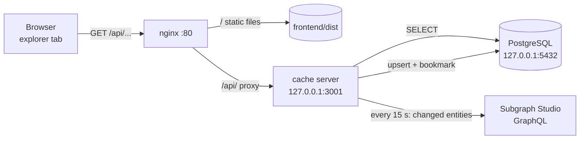

# Cache server and explorer

**English** · [한국어](cache-server.ko.md)

The explorer tab of the app does not query The Graph directly. A small Node server copies the subgraph into our own PostgreSQL every 15 seconds and serves it as a JSON API. Source: [`code/cache-server/`](../code/cache-server).

## Why

| Querying Subgraph Studio from the browser | Cache server |
|---|---|
| Every visitor hits the rate-limited Studio endpoint | One process pulls changes every 15 s, visitors read our DB |
| Data is only in Studio | A copy lives in our PostgreSQL, queryable with SQL |
| GraphQL queries live in the frontend | The frontend calls plain URLs (`/api/pool`), the queries live on the server |

## Architecture



Only nginx (80/443) and SSH (22) are reachable from the internet. The cache server and PostgreSQL listen on `127.0.0.1` and are also blocked by the firewall.

## Files

| File | Role |
|---|---|
| `src/db.ts` | Connection pool (`DATABASE_URL`), `initDb()` creates the tables, `getLastBlock()` / `setLastBlock()` read and write the sync bookmark |
| `src/sync.ts` | `gql()` sends a GraphQL request; `ENTITIES` maps subgraph fields to columns; `upsert()` inserts or updates one row; `syncOnce()` runs one sync pass |
| `src/server.ts` | `sendJson()` writes a JSON response; `routes` maps a path to a SQL query; `startServer()` listens on `127.0.0.1` |
| `src/index.ts` | `initDb()` → `startServer(3001)` → `loop()` (sync every 15 s) |

## Tables

Column names are the subgraph field names in snake_case (PostgreSQL lowercases unquoted identifiers). Token amounts are `NUMERIC(78,0)`: a uint256 has at most 78 digits, so wei values are stored exactly. The `pg` driver returns them as strings; the frontend converts them with `BigInt()`.

| Table | Columns |
|---|---|
| `pools` | id, token_a, token_b, reserve_a, reserve_b, total_liquidity, swap_count |
| `swaps` | id, trader, token_in, amount_in, amount_out, timestamp, tx_hash |
| `liquidity_events` | id, type, provider, amount_a, amount_b, liquidity, timestamp |
| `listings` | id, seller, nft, token_id, payment_token, price, status, buyer (NULL until sold), created_at |
| `nfts` | id, owner |
| `sync_state` | key, value (`lastBlock` = the bookmark) |

## Sync algorithm

`syncOnce()`:

1. `from = getLastBlock()` (0 on the first run).
2. `head = _meta.block.number`, the block the subgraph has indexed up to.
3. For each entity, page through `first: 1000, orderBy: id, block: { number: head }, where: { _change_block: { number_gte: from }, id_gt: cursor }` and `upsert` every row.
4. `setLastBlock(head)`.

- `_change_block` returns entities created **or updated** since `from`, so a listing that goes from ACTIVE to SOLD is fetched again and updated in place.
- `block: { number: head }` pins every page to the same block, so new blocks arriving during a pass cannot mix into the result.
- The bookmark moves only after all entities are stored. If a pass fails, the next one repeats the same range; `upsert` makes that safe.
- `loop()` uses `setTimeout` after each pass (not `setInterval`), so two passes never overlap. Errors are logged and the loop continues.

What one on-chain action changes in the next pass:

| Action | Rows fetched |
|---|---|
| swap | Pool (updated), Swap (new) |
| add / remove liquidity | Pool, LiquidityEvent |
| list NFT | Listing (new), Nft (owner → AMM) |
| buy NFT | Listing (SOLD), Nft (owner → buyer) |
| cancel listing | Listing (CANCELLED), Nft (owner → seller) |

Observed: first run `{ from: 0, changed: 7 }` (1 pool, 1 swap, 1 liquidity event, 1 listing, 3 NFTs), second run `changed: 0`; after one swap, `2 rows`.

## API

| Path | Returns | SQL |
|---|---|---|
| `/api/pool` | one object (or `null`) | `SELECT * FROM pools` |
| `/api/swaps` | latest 20 | `ORDER BY timestamp DESC LIMIT 20` |
| `/api/liquidity` | latest 20 | `ORDER BY timestamp DESC LIMIT 20` |
| `/api/listings?status=ACTIVE\|SOLD\|CANCELLED` | listings, newest first | `WHERE status = $1` when `status` is given |
| `/api/nfts?owner=0x…` | NFTs by id | `WHERE owner = $1` (owner lowercased) when `owner` is given |

Unknown paths return 404, database errors return 500 with `{"error":"internal error"}` (details go to the server log only). Query string values are always passed as `$1` parameters, never concatenated into SQL. `owner=x' OR '1'='1` and `owner=x'; DROP TABLE nfts; --` both return `[]` and leave the table intact.

## Explorer tab

`frontend/src/explorer.tsx`, data from `api()` in `frontend/src/api.ts` (`fetch('/api' + path)`), refreshed every 10 s by react-query.

| Component | API |
|---|---|
| `PoolStats` | `/api/pool` |
| `History` | `/api/swaps` and `/api/liquidity` in parallel (`Promise.all`) |
| `MarketHistory` | `/api/listings`, filter buttons ALL / ACTIVE / SOLD / CANCELLED (the filter is part of the `queryKey`) |
| `NftOwners` | `/api/nfts?owner=` with `encodeURIComponent`; owner = AMM is shown as "held by the market" |

In development, Vite proxies `/api` to `127.0.0.1:3001` (`frontend/vite.config.ts`). In production nginx does the same, so the frontend code is identical in both.

## Run locally

```bash
cd code/cache-server
npm install
echo 'DATABASE_URL=postgres://<user>:<password>@localhost:5432/<db>' > .env   # gitignored
npm run dev                       # API on http://127.0.0.1:3001, syncs every 15 s
```

If PostgreSQL is on a remote server bound to `127.0.0.1`, open an SSH tunnel **on the machine running the cache server** and use port 15432 in `DATABASE_URL`:

```bash
ssh -N -o ServerAliveInterval=30 -L 15432:localhost:5432 <user>@<server>
```

`SUBGRAPH_URL` and `PORT` can also be set in `.env` (defaults: the Studio query URL and 3001).

## Deploy to a Linux server (Ubuntu, nginx)

PostgreSQL setup (once):

```bash
sudo apt install -y postgresql
sudo -u postgres createuser tokenzswap
sudo -u postgres createdb -O tokenzswap tokenzswap
sudo -u postgres psql -c "\password tokenzswap"     # typed, not stored in shell history
```

Cache server:

```bash
# server
sudo apt install -y nodejs npm                  # Node 20.6+ for --env-file
mkdir -p ~/tokenzswap/cache-server
# local machine
rsync -av --exclude node_modules --exclude .env code/cache-server/ <user>@<server>:~/tokenzswap/cache-server/
# server
cd ~/tokenzswap/cache-server && npm ci
nano .env                                       # DATABASE_URL=postgres://tokenzswap:<password>@localhost:5432/tokenzswap
chmod 600 .env
sudo cp <repo>/deployment/server/tokenzswap-cache.service /etc/systemd/system/
sudo systemctl daemon-reload
sudo systemctl enable --now tokenzswap-cache
journalctl -u tokenzswap-cache -f               # logs
```

Frontend and nginx:

```bash
# server
sudo apt install -y nginx
sudo mkdir -p /var/www/tokenzswap && sudo chown "$USER" /var/www/tokenzswap
# local machine
cd frontend && npm run build && cd ..
rsync -av --delete frontend/dist/ <user>@<server>:/var/www/tokenzswap/
# server
sudo cp <repo>/deployment/server/nginx-tokenzswap.conf /etc/nginx/sites-available/tokenzswap
sudo ln -s /etc/nginx/sites-available/tokenzswap /etc/nginx/sites-enabled/
sudo rm /etc/nginx/sites-enabled/default
sudo nginx -t && sudo systemctl reload nginx
```

Firewall and SSH:

```bash
sudo ufw allow OpenSSH            # before enabling
sudo ufw allow 'Nginx Full'       # 80, 443
sudo ufw enable
echo 'PermitRootLogin no' | sudo tee /etc/ssh/sshd_config.d/10-hardening.conf
sudo sshd -t && sudo systemctl reload ssh
sudo apt install -y fail2ban && sudo systemctl enable --now fail2ban
```

Checks:

| Command | Expected |
|---|---|
| `sudo ss -ltnp \| grep -E '5432\|3001'` | both on `127.0.0.1` only |
| `curl -s http://<server>/api/pool` (from outside) | pool JSON |
| `nc -z <server> 3001`, `nc -z <server> 5432` (from outside) | closed |
| `sudo fail2ban-client status sshd` | jail active |

To update after a code change: rerun the `rsync` for the cache server and `sudo systemctl restart tokenzswap-cache`, or rebuild and rerun the `rsync` for `dist` (nginx needs no reload).

## Limitations

| Limitation | Effect | Possible fix |
|---|---|---|
| HTTP only | No TLS without a domain name | Point a domain at the server and run certbot (`sudo certbot --nginx`) |
| Up to ~15 s + indexing delay | The explorer lags the chain by the subgraph's indexing time plus one loop | Lower the interval, or index events directly |
| Depends on Subgraph Studio | If the Studio endpoint is down, the cache stops updating (it keeps serving the last data) | Publish the subgraph to the decentralized network or run graph-node |
| Lists capped at 20 | `/api/swaps`, `/api/liquidity` return the latest 20 | Add `?limit=` / `?before=` pagination |
| SSH password login is enabled | Brute force is limited by fail2ban and a strong password | Switch to key-only login (`PasswordAuthentication no`) |
| Deletions are not mirrored | `_change_block` only returns entities that still exist, so an entity the subgraph removes (e.g. after a chain reorg) stays in the cache | Periodic full resync (bookmark to 0) |
